# 한국 전통 소재 머티리얼 제작

**한국적인 3D 작품을 위한 렌더링 기법 제시** · 갓의 섬유 엮임과 나전칠기 자개의 간섭색을 실시간으로 표현하는 머티리얼 제작

| 항목 | 내용 |
| --- | --- |
| 기간 | 2025.09 ~ 2025.12 |
| 참여 인원 | **2인** |
| 담당 역할 | Graphics Engineer |
| 기술 스택 | Unity 6 (URP) · HLSL · C++ · OpenGL · Dear ImGui |

> 2인 팀 프로젝트 중 **서문현모 담당 영역**을 중심으로 정리

## 핵심 성과

- **2025 교내 미디어데이 비주얼 컴퓨팅 부문 우수상** 수상
- **갓 머티리얼 제작** · 곡면에 맞춘 원형·방사형 엮임 패턴과 챙의 굵은 마감 처리 구현
- **자개 머티리얼 개선** · 가시광선 샘플을 **3개에서 17개로 확장**하고, 층별 두께와 투명 코팅을 반영해 자연스러운 간섭색 구현
- **디버깅 렌더러 제작** · C++·OpenGL·Dear ImGui 기반 실시간 렌더링 환경 구성

**대표 렌더링 결과**

<table>
<tr><th>갓(흑립)</th><th>자개 재질</th><th>나전칠기 적용</th></tr>
<tr>
<td width="33%" valign="middle"></td>
<td width="33%" valign="middle">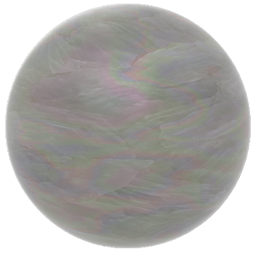</td>
<td width="34%" valign="middle">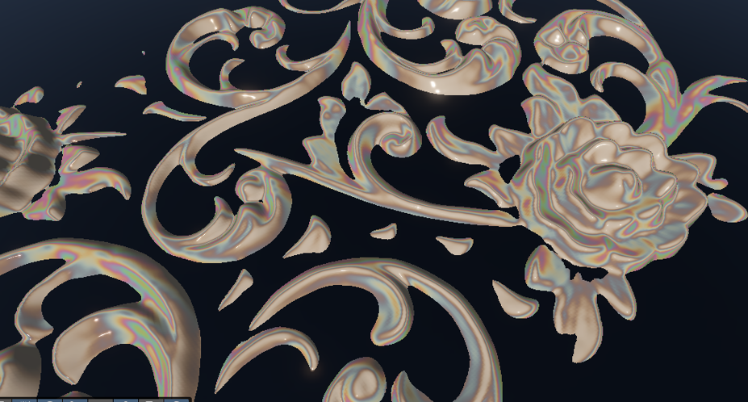</td>
</tr>
</table>

## 검증 및 협업

- **문화체육관광부 스마트 머티리얼**과 비교해 곡면의 엮임 방향, 테두리 마감, 자개 반사색의 개선점 분석
- **자개의 광학적 특성에 관한 참고문헌** 검토 및 굴절·계면 반사·박막 간섭의 물리적 특성 재현
- **지도교수 피드백**을 받아 초기 구현의 한계를 정리하고 **2차 개선**에 반영

**보고서 및 발표 자료**

<table>
<tr><th>미디어프로젝트 보고서 표지</th><th>2025-2 AJOU SOFTCON 발표 포스터</th></tr>
<tr>
<td width="50%" valign="top"><a href="assets/project-report-cover.png">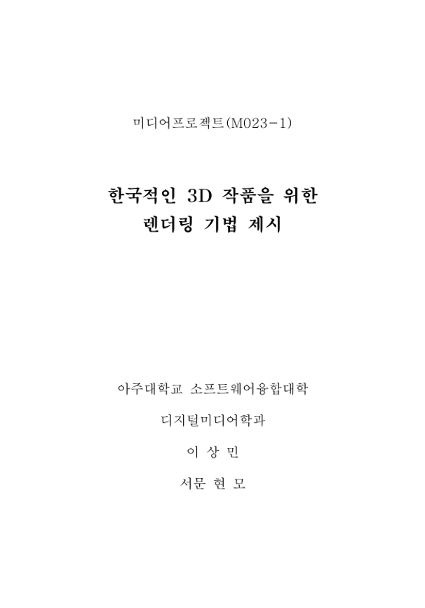</a></td>
<td width="50%" valign="top"><a href="assets/ajou-softcon-poster.png">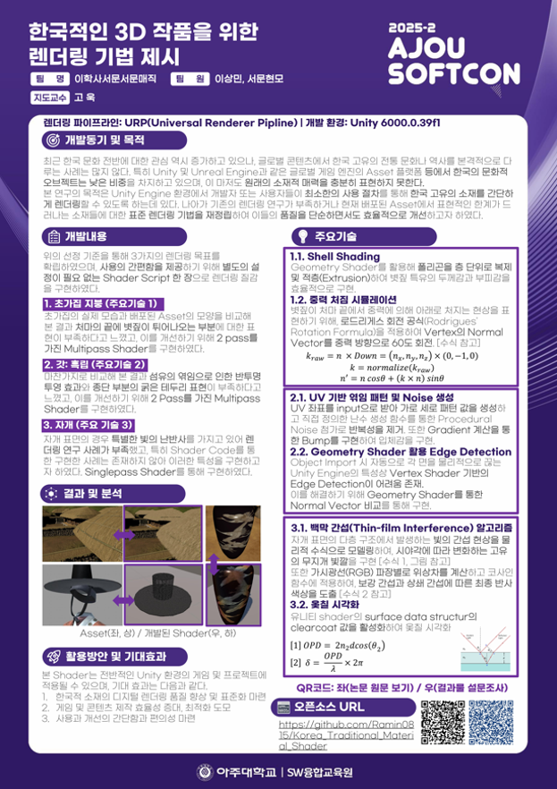</a></td>
</tr>
</table>

## 프로젝트 의의

- **외부 연구 자료 조사 및 물리 특성 재현** · 참고문헌에서 확인한 광학 특성을 셰이더 계산으로 구현
- **그래픽스 엔지니어 역량 향상** · 재질 파라미터와 조명 조건을 확인할 수 있는 자체 렌더링 환경 제작
- **피드백 기반 개발 경험** · 초기 결과의 시각적·기술적 한계 분석 후 구현 방법 개선

## 구현 과정

### 01 갓(흑립) 머티리얼 제작

**갓의 곡면 기하에 맞춘 엮임 방향**, 섬유 패턴의 안정성, 챙의 **테두리 마감** 개선

**초기 구현 및 개선점 분석**

- 갓 전체에 **단일 직선 격자**를 적용한 결과, 곡면의 형태와 실제 섬유의 엮임 방향이 일치하지 않는 문제 발생
- **Geometry Shader**에서 법선의 차이로 모서리를 찾고, 해당 위치에 두꺼운 <strong>쿼드(Quad)</strong>를 생성해 테두리 표현
- Geometry Shader에 의존하는 방식에서 **버전별 동작 불안정성**과 **최적화 문제** 발생 가능성 확인

**해결 방안 도출**

- 윗면과 옆면을 **원과 원기둥**으로 나누고, 각 표면의 기하에 맞춰 **원형·방사형 엮임 패턴** 구성
- Geometry Shader를 제거하고 **원기둥의 위아래 경계**를 직접 탐색하는 방식으로 수정
- 탐색된 모서리에 **별도의 고리형 프리미티브**를 생성해 챙과 테두리의 굵은 마감 표현
- **픽셀당 실이 차지하는 면적의 비율**을 반영하는 안티앨리어싱 적용으로 촘촘한 섬유 패턴의 안정성 확보

**실행 결과**

<table>
<tr><th>초기 구현</th><th>2차 개선</th></tr>
<tr>
<td width="50%" valign="top">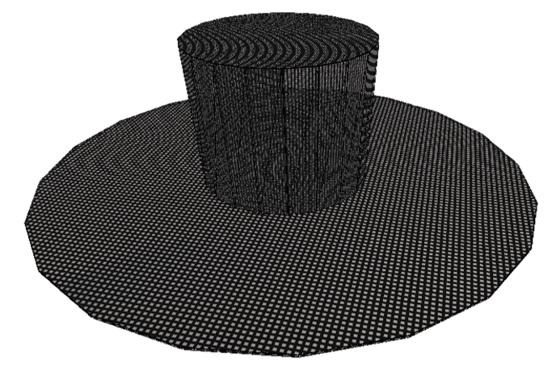 직선 격자 및 Geometry Shader 기반 테두리</td>
<td width="50%" valign="top">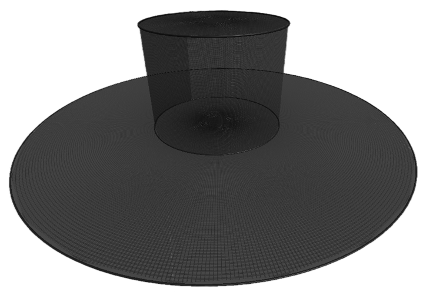 곡면 엮임 패턴 및 고리형 프리미티브 기반 테두리</td>
</tr>
</table>

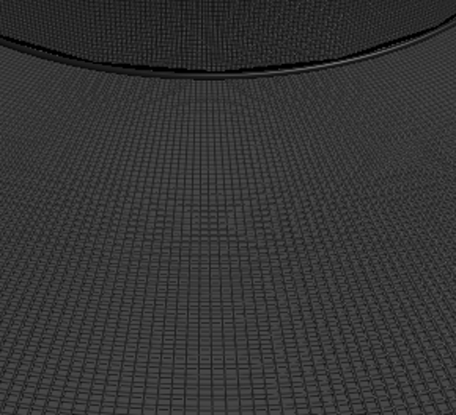

*확대 표면 · 챙의 섬유 엮임과 몸체 경계의 마감 확인*

[갓 셰이더](https://github.com/Ramin0815/Korea_Traditional_Material_Shader/blob/main/Gat.shader) · [갓 형상 연동 코드](https://github.com/Ramin0815/Korea_Traditional_Material_Shader/blob/main/GatGeometryBinder.cs)

### 02 나전칠기(자개) 머티리얼 제작

**간섭색 계산의 파장 수**를 늘리고, **층별 두께와 투명 마감 코팅**을 조절할 수 있는 렌더링 환경 구성

**초기 구현 및 개선점 분석**

- 내부 굴절각의 코사인 대신 **표면 법선과 시선 벡터의 내적 N·V**를 사용해, 내적이 같은 지점에서 동일한 색상이 출력되는 문제 발생
- 두 광선의 간섭 세기를 **코사인 함수**로 단순화해 **계면별 반사율** 미반영
- RGB 채널마다 **대표 파장 1개씩, 총 3개**로 간섭색을 근사해 세밀한 색상 변화 표현에 한계
- **나전칠기 마감 코팅**의 반사 표현 미흡

**해결 방안 도출**

- 외부 입사각과 <strong>스넬의 법칙(Snell’s Law)</strong>으로 내부 굴절각을 계산하고, 굴절각을 반영한 **광경로차** 계산
- **프레넬 방정식**을 적용해 각 계면의 프레넬 계수를 계산하고, 이를 바탕으로 **전체 반사율** 산출
- 간섭색 계산에 사용하는 파장을 **3개에서 17개로 확장**해 **380~700nm 구간을 20nm 간격**으로 샘플링
- Unity URP의 **Clear Coat**, **Thickness Map**, **층 두께 노이즈**를 반영해 투명 코팅과 국소 간섭색 변화 표현

**실행 결과**

<table>
<tr><th>초기 구현</th><th>2차 개선</th></tr>
<tr>
<td width="50%" valign="top">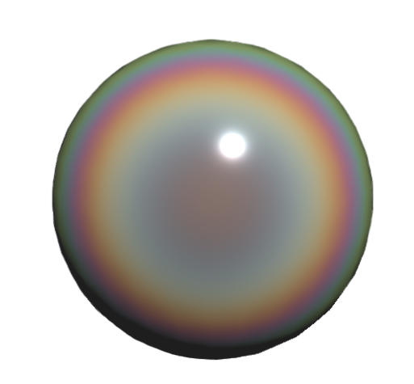 RGB 대표 파장 기반 간섭색 근사</td>
<td width="50%" valign="top">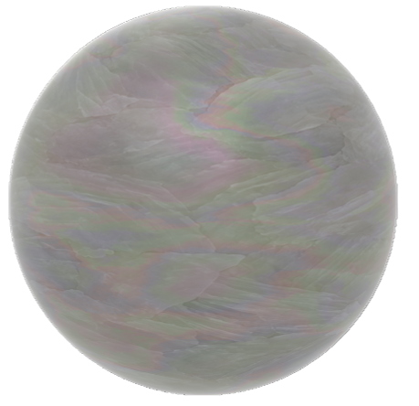 파장 샘플 확장 및 층별 두께·코팅 적용</td>
</tr>
</table>

**디버깅 렌더러 제작**

- **C++·OpenGL·Dear ImGui** 기반 자체 렌더러 제작
- **재질 파라미터, 조명, 미리보기 형상**을 변경하며 투명 코팅과 간섭색 변화 확인

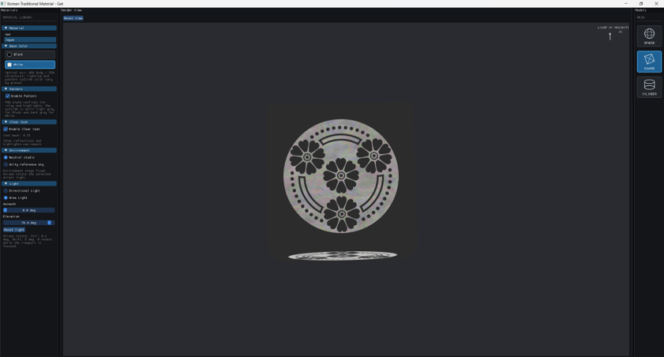

**나전칠기 적용 결과**

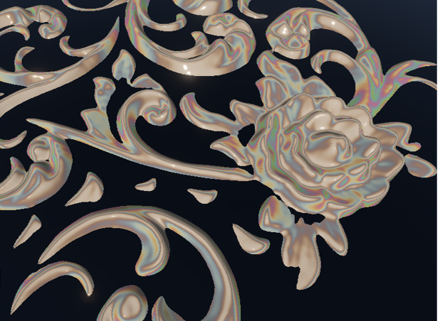

[초기 자개 셰이더](https://github.com/Ramin0815/Korea_Traditional_Material_Shader/blob/main/JagaeShader%20%281%29.shader) · [개선된 자개 셰이더](https://github.com/Ramin0815/Korea_Traditional_Material_Shader/blob/main/modifyJagae.shader)
